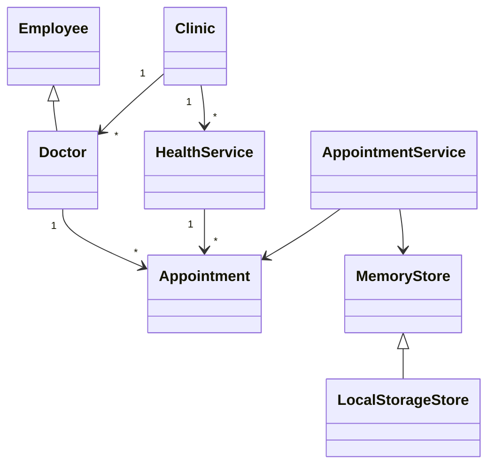

# Sağlık Randevu Sistemi Proje Raporu

## 1 Projenin amacı

Uygulamanın amacı farklı kliniklerde sunulan sağlık hizmetleri için doktor uygunluğunu dikkate alarak randevu oluşturmaktır. Sistem hasta, doktor ve klinik yöneticisi olmak üzere üç farklı kullanıcı rolü sunar. Randevu kaydı oluşturulurken seçilen doktorun hizmeti verip vermediği, zaman aralığında çalışıp çalışmadığı ve başka bir randevusunun bulunup bulunmadığı kontrol edilir.

## 2 Gereksinimler

- Birden fazla klinik veya şube görüntülenebilmelidir.
- Kliniklerin adresi, çalışma saatleri ve bölümleri tanımlanabilmelidir.
- Hizmetlerin adı, bölümü, süresi ve ücreti saklanmalıdır.
- Doktorların uzmanlığı, çalıştığı klinik, sunduğu hizmetler ve uygunluk saatleri tanımlanmalıdır.
- Hasta uygun klinik, hizmet, doktor, tarih ve saat seçerek randevu oluşturabilmelidir.
- Hasta, adını girerek yalnızca kendi randevularını görüntüleyebilmeli ve aktif kaydını iptal edebilmelidir.
- Sistem doktor takvimi, hizmet süresi ve mevcut randevulara göre uygun saatleri otomatik üretmelidir.
- Geçmiş tarih ve saatler randevu seçeneği olarak sunulmamalıdır.
- Aynı doktor için zaman çakışması engellenmelidir.
- Doktor veya yönetici bekleyen randevuyu onaylayabilmeli ya da iptal edebilmelidir.

## 3 Sınıf tasarımı

`Clinic` kurum bilgisini ve bölümleri, `HealthService` hizmet süresi ile ücretini tutar. `Employee` çalışanların ortak alanlarını içerir. `Doctor` bu sınıftan kalıtım alır ve uzmanlık ile uygunluk davranışını ekler. `Appointment` durum geçişlerini ve çakışma hesabını kapsüller. `AppointmentService` randevu oluşturma iş kurallarını tek yerde toplar.

## 4 Nesneye dayalı programlama ilkeleri

**Kapsülleme:** Randevuyu onaylama, iptal etme ve zaman çakışmasını hesaplama işlemleri `Appointment` sınıfının metotlarıdır. Dış kod randevu durumunun nasıl değiştiğini bilmek zorunda değildir.

**Kalıtım:** `Doctor`, çalışanlara ait ortak alanları içeren `Employee` sınıfından türetilmiştir. Böylece ad, rol, klinik ve hizmet bilgileri tekrar edilmez.

**Çok biçimlilik:** `MemoryStore` yalnızca bellekte çalışırken `LocalStorageStore` kalıtım yoluyla aynı arayüzü kullanır ve `persist` davranışını tarayıcı depolamasına göre değiştirir. Randevu servisi hangi veri saklama sınıfının kullanıldığını bilmeden çalışır.

**Soyutlama ve sorumluluk ayrımı:** Arayüz kodu, alan kuralları ve veri erişimi ayrı dosyalardadır. `AppointmentService` bir randevunun oluşturulup oluşturulamayacağına karar verir; ekran çizimiyle ilgilenmez.

## 5 Temel senaryo

1. Hasta rolü seçilir.
2. Hasta adı, klinik ve hizmet bilgisi girilir.
3. Sistem yalnızca seçilen hizmeti sunan doktorları listeler.
4. Tarih seçildiğinde doktorun çalışma aralıkları 15 dakikalık başlangıç seçeneklerine dönüştürülür.
5. Hizmet süresini aşan, geçmişte kalan veya mevcut kayıtlarla çakışan saatler listeden çıkarılır.
6. Hasta yalnızca kalan uygun saatlerden birini seçer.
7. Çakışma yoksa ücret ve süre bilgisiyle bekleyen randevu oluşturulur.
8. Hasta aynı adla kendi randevularını görüntüleyebilir ve aktif kaydını iptal edebilir.
9. Doktor rolüne geçilerek randevu onaylanır veya iptal edilir.

## 6 Test yaklaşımı

Projede Node.js yerleşik test aracı kullanılmıştır. Testler başarılı randevu oluşturmayı, uygun olmayan ve geçmiş zamanların reddedilmesini, uygun saat listesinin üretilmesini, dolu aralıkların listeden çıkarılmasını, aynı zaman aralığındaki çakışmayı, hasta adı yetkilendirmesini, iptal edilen saatin yeniden kullanılmasını ve onay durumuna geçişi doğrular. Harici test kütüphanesine ihtiyaç yoktur.

## 7 Geliştirme önerileri

Gerçek kullanım için kullanıcı kimlik doğrulaması, sunucu taraflı bir API, ilişkisel veritabanı, doktorun izin günleri, e-posta veya SMS bildirimi ve ödeme modülü eklenebilir. Klinik yöneticisinin ekrandan yeni kurum, hizmet ve çalışan ekleyebileceği formlar da sonraki sürümün kapsamına alınabilir.
